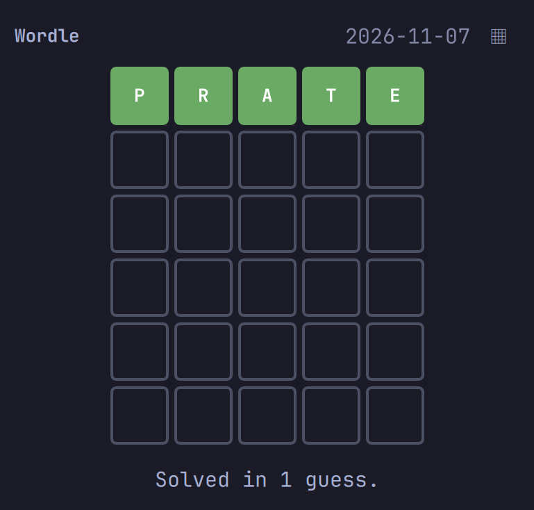

# Wordle

An [Omarchy](https://omarchy.org/) plugin for playing Wordle straight from your bar. Click the **W** widget, type a five-letter guess, and press **Enter**.

[](preview.png)

## Install

```bash
omarchy plugin add https://github.com/TibeDev/Omardle.git --enable
```

The GitHub repository is private; installers need repository access.

## Usage

- Type guesses while the popup has focus. Press **Enter** to submit and **Backspace** to edit.
- Click the calendar icon to choose a puzzle date. Dates before Wordle's first puzzle or after today are disabled.
- Guesses save separately for each puzzle date.

### Storage

Saved games live in `~/.local/state/omarchy/wordle-games.json`. The accepted-guess list is bundled in `Dictionary.js` from [darkermango/5-Letter-words](https://github.com/darkermango/5-Letter-words). Both copyright notices and MIT terms appear in `LICENSE`.

## Remove

```bash
omarchy plugin remove tibevdb.wordle
```

## Disclaimer

Wordle is a New York Times game. This unofficial plugin is not affiliated with or endorsed by The New York Times Company.

This plugin was vibe coded with [OpenCode](https://opencode.ai/).
